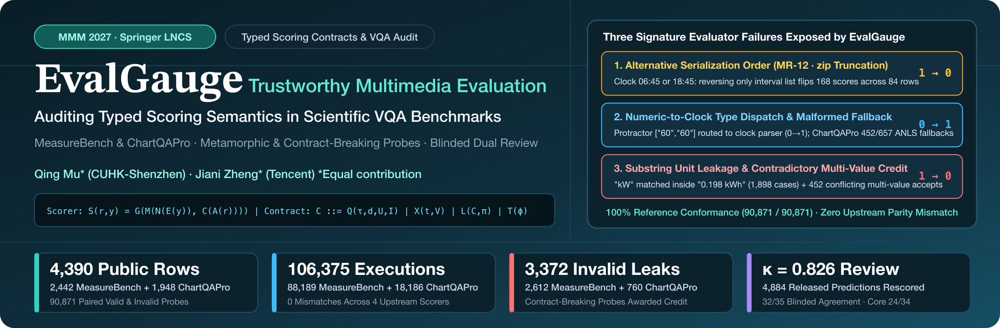
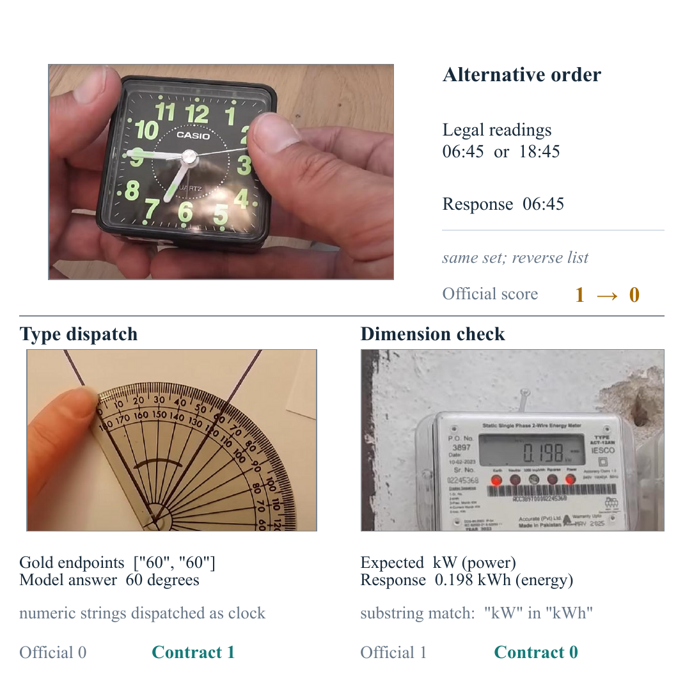
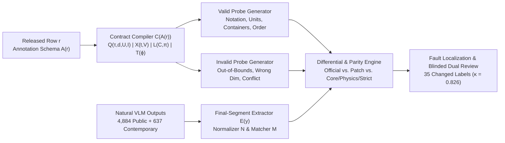
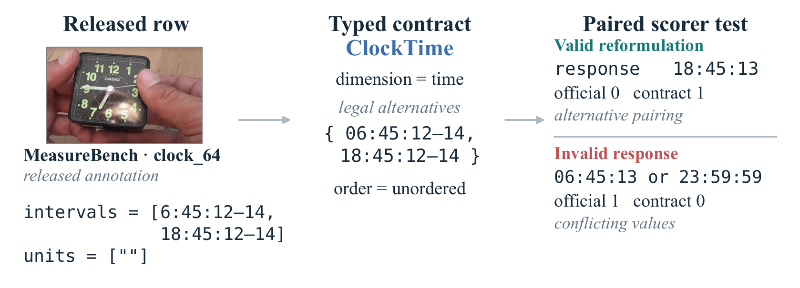
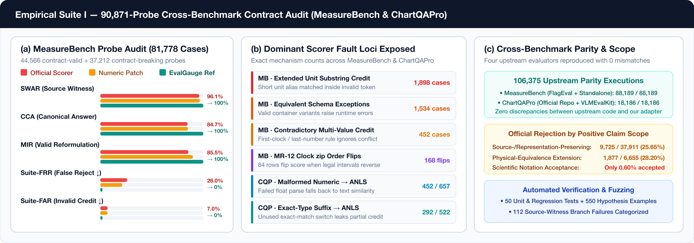
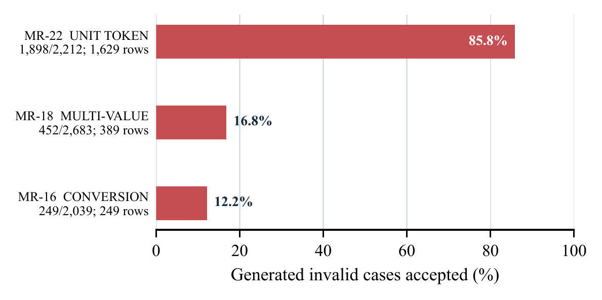
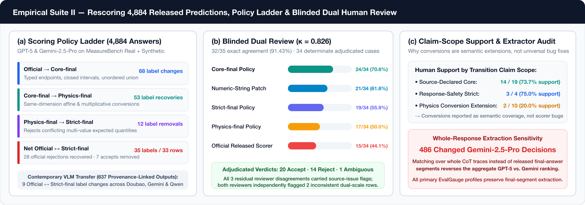
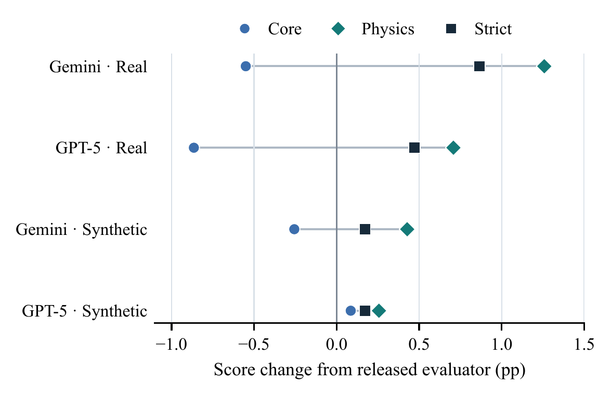

<div align="center">



<br/>

# EvalGauge: Auditing Typed Scoring Semantics in Scientific VQA Benchmarks

**Qing Mu**<sup>1,*</sup> · **Jiani Zheng**<sup>2,*</sup>  
<sup>1</sup>The Chinese University of Hong Kong, Shenzhen &nbsp;&nbsp;|&nbsp;&nbsp; <sup>2</sup>Tencent  
<sup>*</sup>Equal contribution (`qingmu@link.cuhk.edu.cn`, `ninajnzheng@tencent.com`)

[](paper/main.pdf)
[](paper/main.pdf)
[](data/)
[-2563EB?style=for-the-badge)](analysis/upstream_parity.json)
[](tests/)
[-16A34A?style=for-the-badge)](scripts/verify_release.py)
[](LICENSE)

[**📄 Camera-Ready Paper**](paper/main.pdf) · [**⚡ 30-Second Verification**](#-30-second-offline-verification) · [**🔍 Three Signature Failures**](#-motivation-when-the-scorer-changes-the-definition-of-correctness) · [**📐 Typed Scoring Contracts**](#-typed-scoring-contracts--architecture) · [**📊 Empirical Dashboards**](#-empirical-results--visual-dashboards) · [**👥 Blinded Dual Review**](#-rescoring-4884-released-predictions--blinded-dual-human-review) · [**🗂️ Repository Structure**](#-repository-architecture) · [**📝 Citation**](#-citation)

</div>

---

## 🌟 Overview & Key Highlights

Automatic evaluation determines which model outputs count as correct in a scientific or multimedia benchmark. While short numerical, unit-bearing, or structured answers in benchmarks like **MeasureBench** and **ChartQAPro** appear unambiguous, their official evaluators make hidden control-flow choices about **answer extraction, type routing, unit matching, interval pairing, list ordering, and text-similarity fallbacks**.

**EvalGauge** compiles released benchmark annotations and scoring rules into **typed scoring contracts**, systematically generates paired **meaning-preserving** and **contract-breaking** probes across every public row, and audits both synthetic probes and natural Vision-Language Model (VLM) outputs:

- **🌐 Full-Population Cross-Benchmark Audit (`4,390` Rows $\to$ `90,871` Probes)**: Compiles all **2,442 MeasureBench** rows into **81,778** paired probes (`44,566` valid + `37,212` invalid) and all **1,948 ChartQAPro** rows into **9,093** probes (`5,923` valid + `3,170` invalid). Reference contract evaluators achieve **100% conformance (`90,871 / 90,871`)**.
- **🎯 Exact Upstream Parity (`106,375` Executions, `0` Mismatches)**: Reproduces four upstream evaluator implementations—MeasureBench's released FlagEvalMM scorer and standalone repository (`88,189` executions) plus ChartQAPro's official scorer and VLMEvalKit adapter (`18,186` executions)—with **zero discrepancies**.
- **💥 Order-Sensitive Alternatives, Type Confusion & Invalid Credit**:
  - **MR-12 Alternative Reordering**: Reversing only the scorer-side serialization of legal clock alternatives flips **168 binary decisions across 84 MeasureBench rows** (`86` declared alternatives silently truncated by `zip`).
  - **MeasureBench Invalid Leakage**: The official scorer awards full credit to **2,612 / 37,212 (7.02%)** contract-breaking probes, driven by substring unit matching (`1,898` extended unit tokens like `"kW"` inside `"0.198 kWh"`) and contradictory multi-value responses (`452` cases).
  - **ChartQAPro Fallback Leakage**: Awards nonzero official credit to **760 / 3,170 (23.97%)** invalid probes because an unused exact-match switch leaks ANLS credit on **292 / 522** exact-type rows and failed numeric parses fall back to ANLS on **452 / 657** malformed numeric suffixes.
- **👥 Rescoring `4,884` Released Predictions & Blinded Dual Review ($\kappa = 0.826$)**: Rescoring all `4,884` released GPT-5 and Gemini-2.5-Pro predictions across our policy ladder (`Official` $\xrightarrow{68}$ `Core-final` $\xrightarrow{53}$ `Physics-final` $\xrightarrow{12}$ `Strict-final`) changes **35 net Official$\leftrightarrow$Strict labels on 33 rows**. Two blinded human reviewers achieve **91.43% exact agreement (`32/35`, $\kappa = 0.826$)**, and third-reviewer adjudication aligns most closely with the source-declared **`Core-final` policy (`24/34 = 70.6%`)**.

---

## 🔍 Motivation: When the Scorer Changes the Definition of Correctness

<div align="center">
  
  <p><em><b>Figure 1 — Three real evaluator failures exposed by EvalGauge while the image, question, and model output remain fixed.</b> (Top) <b>Alternative order (MR-12):</b> reversing the list of legal clock readings (<code>06:45</code> or <code>18:45</code>) flips the official score from <code>1 → 0</code> because <code>zip(intervals, [""])</code> truncates the second interval. (Bottom-Left) <b>Type dispatch:</b> numeric string endpoints <code>["60", "60"]</code> are routed to the clock parser, rejecting the valid answer <code>60 degrees</code> (<code>0 → 1</code>). (Bottom-Right) <b>Dimension check:</b> substring matching finds <code>"kW"</code> inside <code>"0.198 kWh"</code>, awarding credit to an energy reading when power was requested (<code>1 → 0</code>).</em></p>
</div>

---

## 📐 Typed Scoring Contracts & Architecture

For any benchmark row $r$ and model response $y$, **EvalGauge** factors a benchmark scorer into six explicit, auditable stages:

$$
S(r, y) = G\Big(M\big(N(E(y)),\, C(A(r))\big)\Big)
$$

where $A$ interprets the raw annotation schema, $C$ compiles legal answers into a typed contract, $E$ extracts the final response segment, $N$ normalizes quantities and units, $M$ compares the parsed candidate against the compiled contract, and $G$ aggregates branch or element scores.



### The Shared Contract Grammar

$$
\mathcal{C} ::= Q(\tau, d, U, I) \;\mid\; X(t, V) \;\mid\; L(\mathcal{C}_{1:m}, \pi) \;\mid\; T(\phi)
$$

- **$Q(\tau, d, U, I)$ — Quantity Contract**: Numeric or clock quantity with value type $\tau \in \lbrace \mathrm{decimal}, \mathrm{clock} \rbrace$, physical dimension $d$, allowed unit set $U$ (with registered multiplicative $x_b = a x$ and affine temperature $x_b = a x + b$ conversions), and closed intervals $I$.
- **$X(t, V)$ — Exact Typed Contract**: Year, multiple-choice option, or boolean fact $t$ with legal value set $V$ (no ANLS text-similarity fallback leakage).
- **$L(\mathcal{C}_{1:m}, \pi)$ — Structured List Contract**: Element contracts $\mathcal{C}_{1:m}$ governed by order policy $\pi \in \lbrace \mathrm{ordered}, \mathrm{unordered} \rbrace$.
- **$T(\phi)$ — Text Similarity Contract**: Retains a benchmark's native text-similarity threshold $\phi$ (e.g., ANLS) strictly for genuine free-text answers.

<div align="center">
  
</div>

---

## 📊 Empirical Results & Visual Dashboards

### 1. Cross-Benchmark Scorer Semantics & 90,871-Probe Audit

<div align="center">
  
</div>

#### Cross-Benchmark Execution Summary (Table 2 in Paper)

| Evaluator Family | Public Rows | Generated Cases | Upstream Parity Executions | Source-Witness Full Credit (SWAR) | Invalid Leakage (Contract-Breaking Credit) |
| :--- | :---: | :---: | :---: | :---: | :---: |
| **MeasureBench** (FlagEval + Standalone) | 2,442 | 81,778 | 88,189 (`0` mismatch) | 96.12% (112 branch failures) | **2,612 / 37,212 (7.02%)** |
| **ChartQAPro** (Repo + VLMEvalKit) | 1,948 | 9,093 | 18,186 (`0` mismatch) | 99.38% (12 witness failures) | **760 / 3,170 (23.97%)** |
| **Combined Total** | **4,390** | **90,871** | **106,375 (`0` mismatch)** | — | **3,372 invalid probes credited** |

#### MeasureBench Generated-Probe Audit & Positive Claim-Scope Breakdown (Table 3 in Paper)

| Scorer Policy | SWAR (%) $\uparrow$ | CCA (%) $\uparrow$ | MIR (%) $\uparrow$ | Suite-FRR (%) $\downarrow$ | Suite-FAR (%) $\downarrow$ |
| :--- | :---: | :---: | :---: | :---: | :---: |
| **Official Released Scorer** | 96.12% | 84.66% | 85.48% | 26.03% | 7.02% (`2,612 / 37,212`) |
| **Narrow Numeric-String Patch** | 96.61% | 85.14% | 89.94% | 21.20% | 7.02% (`2,612 / 37,212`) |
| **EvalGauge Reference Contract** | **100.00%** | **100.00%** | **100.00%** | **0.00%** | **0.00% (`0 / 37,212`)** |

| Positive Claim Scope (MeasureBench Valid Probes) | Valid Probes | Official Rejected | Official Rejection Rate (%) |
| :--- | :---: | :---: | :---: |
| **Source- / Representation-Preserving** (notation, wrappers, aliases, containers) | 37,911 | 9,725 | **25.65%** |
| **Physical-Equivalence Extension** (registered same-dimension unit conversions) | 6,655 | 1,877 | **28.20%** |
| **All-Probe Pooled Aggregate** | 44,566 | 11,602 | **26.03%** |

<div align="center">
  
</div>

---

### 2. Rescoring 4,884 Released Predictions & Blinded Dual Human Review

To measure how scorer semantics affect real model evaluations, we rescore all **4,884 GPT-5 and Gemini-2.5-Pro predictions** released with MeasureBench (`Real` + `Synthetic` splits) plus **637 provenance-linked outputs** from three contemporary VLMs (`Doubao Seed 2.1 Turbo`, `Gemini 3.6 Flash`, `Qwen3-VL-8B`).

<div align="center">
  
</div>

#### The Four-Step Scoring Policy Ladder

1. **`Official`**: Released MeasureBench evaluator as distributed.
2. **`Core-final`** (`68` label changes from Official): Typed numeric/clock endpoints, closed intervals, unordered alternative union, token-bounded source-declared units, and released final-answer extraction.
3. **`Physics-final`** (`53` recoveries from Core-final): Adds registered multiplicative and affine temperature conversions within the same physical dimension.
4. **`Strict-final`** (`12` removals from Physics-final; `35` net changes on `33` rows vs. Official): Additionally rejects responses containing conflicting expected-type quantities.

#### Blinded Dual Review & Third-Reviewer Adjudication (`35` Official $\leftrightarrow$ Strict Transitions)

Every Official$\leftrightarrow$Strict label change underwent **two independent blinded human reviews** (`Reviewer A` and `Reviewer B`) plus **third-reviewer adjudication** (`adjudicator.json`) under a finalized dual-scale Standard Operating Procedure (SOP):
- **Inter-Annotator Reliability**: **32 / 35 exact agreement (91.43%)**, three-way **Cohen's $\kappa = 0.826$**. All 3 residual disagreements carried source-issue flags.
- **Adjudicated Verdicts**: **20 Accept**, **14 Reject**, **1 Ambiguous** (`34` determinate cases).
- **Policy Alignment on Determinate Transitions**: **`Core-final` achieves the highest human alignment at `24 / 34 (70.6%)`**, followed by `Numeric Patch (21/34 = 61.8%)`, `Strict-final (19/34 = 55.9%)`, `Physics-final (17/34 = 50.0%)`, and `Official (15/34 = 44.1%)`.
- **Claim-Scope Disaggregation**: Human adjudication supports **`Core-final` in `14 / 19 (73.7%)`** source-declared cases and **`Strict-final` in `3 / 4 (75.0%)`** response-safety cases, but supports **`Physics-final` in only `2 / 10 (20.0%)`** conversion-extension cases—confirming that unit conversions should be reported as semantic extensions rather than universal scorer bug fixes.

| Case ID | Released Model Response | Official $\to$ Strict | Blinded Dual Review & Adjudication Verdict |
| :--- | :--- | :---: | :--- |
| **Protractor 3** | `60°` (Gold: `["60", "60"]`) | `0 → 1` | **Unanimous Accept**: Colon-free numeric-string endpoint was misrouted to the clock parser by Official. |
| **Pressure Gauge 35** | `144 psi (or 10.4 bar)` | `1 → 0` | **Unanimous Reject**: Paired final readings conflict with the gauge's dual scale; Official credited the first match. |
| **Thermometer 13** | `24°C (76°F)` | `0 → 1` | **Unanimous Accept**: Visual `°C` reading is correct; both reviewers independently flagged an inconsistent `°F` source interval. |

<div align="center">
  
</div>

---

## ⚡ 30-Second Offline Verification

All compiled contracts, generated probe decisions, rescoring traces, and blinded human review records are distributed in `analysis/`, `artifacts/`, and `data/`. **No GPU, model API key, or network access is needed.**

### 1. Instant Headline Claim Verification (`< 3 seconds`, Zero Dependencies)

```bash
python3 scripts/verify_release.py
```

**Expected Output:**

```text
EvalGauge offline release verification
[PASS] generated cases: 81,778 + 9,093 = 90,871
[PASS] upstream parity: 106,375 executions, 0 mismatches
[PASS] MR-12: 168 flips / 84 rows; 86 alternatives truncated
[PASS] invalid credit: MeasureBench 2612/37212; ChartQAPro 760/3170
[PASS] released predictions: 4,884 answers; 35 labels / 33 rows changed
[PASS] profile ladder: 68 / 53 / 12 boundary changes
[PASS] dual review: agreement 32/35, kappa 0.826, Core alignment on selected transitions 24/34
[PASS] contemporary transfer: 637 answers, 9 changed labels
[PASS] extraction sensitivity: 486 changes, aggregate order reversed
PASS: all frozen headline claims match the distributed evidence.
```

### 2. Run Full Test Suite & Hypothesis Property-Based Fuzzing (`50` Tests + `550` Examples)

```bash
uv sync --extra dev
uv run ruff check src tests scripts
uv run pytest -q --hypothesis-seed=20260815
```

### 3. Recompute ChartQAPro Probes & Blinded Dual-Review Analytics

```bash
uv run python scripts/run_chartqapro_probe.py --root .
uv run python scripts/analyze_dual_transition_review.py --root .
python3 scripts/verify_release.py
```

### 4. Compile the Camera-Ready MMM 2027 LNCS Paper

```bash
cd paper/mmm2027
tectonic --outdir .. main.tex
```

---

## 🗺️ Claim-to-Evidence Map

Every number, table, and figure in the paper is backed by machine-readable artifacts in this repository (see [paper/claim_evidence_ledger.md](paper/claim_evidence_ledger.md) for the exhaustive ledger):

| Paper Claim / Result | Primary Machine-Readable Evidence |
| :--- | :--- |
| **4,390 public rows $\to$ 90,871 generated probes** | `analysis/audit_summary.json`, `analysis/xbench_chartqapro_summary.json` |
| **106,375 upstream parity executions (`0` mismatch)** | `analysis/upstream_parity.json`, `analysis/xbench_chartqapro_summary.json` |
| **MR-12: 168 score flips / 84 rows / 86 truncated alternatives** | `analysis/mr12_source_schema_validation.json` |
| **MeasureBench invalid credit: `2,612 / 37,212` (7.02%)** | `analysis/differential_summary.json`, `data/negative_cases.parquet` |
| **ChartQAPro invalid leakage: `760 / 3,170` (23.97%)** | `analysis/xbench_chartqapro_summary.json`, `data/xbench_chartqapro_cases.parquet` |
| **4,884 released predictions $\to$ 35 changed labels on 33 rows** | `analysis/public_model_rescoring.json`, `artifacts/public_model_changed_cases.jsonl` |
| **Policy ladder boundaries (`68` / `53` / `12`)** | `analysis/scoring_profile_analysis.json`, `artifacts/scoring_profile_matrix.csv` |
| **Blinded dual review (`32/35`, $\kappa = 0.826$, Core `24/34`)** | `analysis/dual_manual_review_analysis.json`, `artifacts/dual_manual_review_casebook.csv` |
| **Claim-scope support (`Core 14/19`, `Strict 3/4`, `Physics 2/10`)** | `analysis/dual_manual_review_analysis.json`, `analysis/dual_manual_review_report.md` |
| **637 contemporary VLM responses (`9` changed labels)** | `analysis/model_rescoring.json`, `artifacts/model_response_sources.csv` |
| **Whole-response extraction sensitivity (`486` flips & rank reversal)** | `analysis/public_model_rescoring.json` |

---

## 🗂️ Repository Architecture

```text
EvalGauge/
├── assets/                                  # High-DPI banners, empirical dashboards, and 300-DPI paper figures
│   ├── banner.png                           # Flagship project overview banner
│   ├── dashboard_audit_overview.png         # Empirical Suite I: 90,871-Probe Cross-Benchmark Audit
│   ├── dashboard_rescoring_review.png       # Empirical Suite II: Rescoring, Policy Ladder & Dual Review
│   └── paper_figures/                       # High-resolution PNG renders of all paper & supplemental figures
├── src/evalgauge/                           # Core Python package (`evalgauge`)
│   ├── schema.py                            # Typed contract AST: Quantity Q, Exact X, List L, Text T
│   ├── compiler.py                          # Annotation-to-contract compiler & schema diagnostics
│   ├── units.py & conversions.py            # Token-bounded unit registry & affine/multiplicative algebra
│   ├── extraction.py & parser.py            # Final-answer segment extractors & numeric/clock/LaTeX parsers
│   ├── matcher.py                           # Policy-parameterized contract matchers (Core, Physics, Strict)
│   ├── metamorphic.py & negatives.py        # 24-relation valid & contract-breaking probe generators
│   ├── differential.py & audit.py           # Differential execution engine & fault-locus attribution
│   ├── public_rescore.py & rescore.py       # Natural VLM prediction rescoring & extraction sensitivity
│   └── xbench/                              # Cross-benchmark adapters (ChartQAPro & VLMEvalKit parity)
├── data/                                    # Compiled contracts & Parquet decision tables
│   ├── compiled_contracts.jsonl             # 2,442 compiled MeasureBench contracts with branch metadata
│   ├── metamorphic_cases.parquet            # 44,566 contract-valid probes & scorer traces
│   ├── negative_cases.parquet               # 37,212 contract-breaking probes & scorer traces
│   ├── xbench_chartqapro_cases.parquet      # 9,093 ChartQAPro probes & soft-score traces
│   ├── public_model_scores.parquet          # Complete 4,884 released prediction traces across policies
│   └── model_answers.parquet                # 637 provenance-linked contemporary VLM prediction traces
├── analysis/                                # Machine-readable JSON summaries backing all paper claims
├── artifacts/                               # Casebooks, minimal failing cases, HTML report & LaTeX tables
│   ├── evalgauge_report.html                # Interactive self-contained browsable HTML audit report
│   ├── minimal_failing_cases.jsonl          # Minimal witness & probe counterexamples per relation
│   ├── public_model_changed_cases.jsonl     # All label-transition records on released predictions
│   ├── dual_manual_review_casebook.csv      # Complete 35-case blinded review & adjudication casebook
│   └── dual_manual_review/                  # Raw Reviewer A, Reviewer B, SOP-return & Adjudicator JSONs
├── frozen/                                  # Upstream commit hashes, evaluator snapshots & unit registry
├── scripts/                                 # CLI entry points for verification, auditing & figure building
├── tests/                                   # 50 unit/regression tests & 550 Hypothesis property examples
├── paper/                                   # Camera-ready MMM 2027 LNCS paper PDF, source & claim ledger
│   ├── main.pdf                             # Compiled 13-page MMM 2027 Springer LNCS camera-ready PDF
│   ├── claim_evidence_ledger.md             # Exhaustive claim-to-file verification mapping
│   └── mmm2027/                             # Self-contained LaTeX source (main.tex, figures, references.bib)
├── pyproject.toml & uv.lock                 # Reproducible dependency & build configuration
├── SOURCE_DATA.md & RELEASE_SCOPE.md        # Upstream dataset provenance & release boundaries
├── THIRD_PARTY_NOTICES.md                   # License attributions for upstream code and teaser crops
└── LICENSE                                  # MIT License
```

---

## 📝 Citation

If you use **EvalGauge**, our typed scoring contracts, or our benchmark audit artifacts in your research, please cite our MMM 2027 paper:

```bibtex
@inproceedings{mu2027evalgauge,
  title     = {EvalGauge: Auditing Typed Scoring Semantics in Scientific VQA Benchmarks},
  author    = {Mu, Qing and Zheng, Jiani},
  booktitle = {Proceedings of the 33rd International Conference on Multimedia Modeling (MMM)},
  series    = {Lecture Notes in Computer Science (LNCS)},
  publisher = {Springer},
  year      = {2027},
  note      = {Equal contribution}
}
```

---

## 📜 License & Third-Party Notices

- **EvalGauge Software & Audit Framework**: Released under the [MIT License](LICENSE).
- **Upstream Benchmarks & Teaser Crops**: MeasureBench and ChartQAPro annotations, evaluator snapshots, and the three CC BY-SA 4.0 teaser crops remain subject to their respective upstream licenses as documented in [SOURCE_DATA.md](SOURCE_DATA.md) and [THIRD_PARTY_NOTICES.md](THIRD_PARTY_NOTICES.md).
